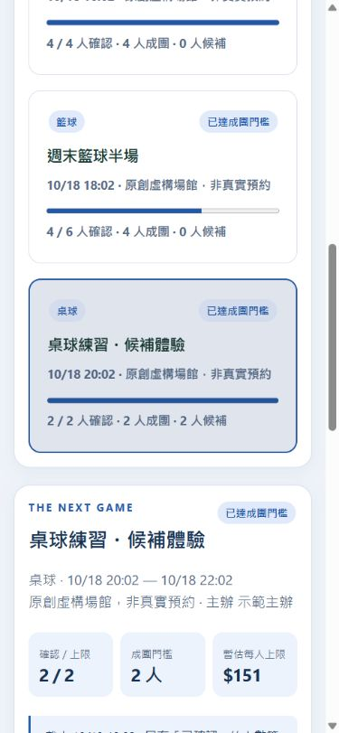

# RallyReady · 揪團，不再靠猜

> A quorum-aware pickup sports coordinator with transactional waitlists and attendance-based cost splits.

給校園臨打主辦人的手機優先網頁 App：把「說要來」拆成**已確認、候補保留、實際出席**三種不同承諾。人數不足時清楚顯示風險，而不是讓大家到場才發現成不了團。

全新 AI 協作作品集初版，不是先前 Flutter 課程作業的原始碼重建。未串接真實場館、收款、Email 或背景推播；示範資料全部虛構，沒有真實使用者或節省工時數據。



## 為什麼不是普通報名表

- **成團狀態機**：招募中 → 達標／人數不足待補位 → 截止成團或取消 → 出席與結算。候補保留不算成團人數。
- **不超賣的候補**：容量內確認，額滿進 FIFO 隊列；退出釋出限時邀請，必須本人接受。保留中佔容量，逾時才交下一位，重排回隊尾。
- **到場才有的帳**：主辦人記錄簽到，活動結束依出席者以整數新台幣平分，餘數按報名先後分配；結算快照不可更改，不實際收款。
- **規則可見**：門檻、截止、回覆時間、備案、總費用、自己的報名狀態、站內通知與主辦流程紀錄。
- **分享與隱私**：訪客看公開活動摘要；主辦人及曾報名者才可看暱稱名單。不收集電話、電子郵件、學號或定位。
- **PWA**：桌機／手機介面、可安裝 manifest 與原創圖示；離線只保留公開介面，不快取個人 API，也不偷偷排程報名。

市售 OpenSports 已有成熟的自動候補，不能把這當作我們發明。本案聚焦可自架的校園小團、明確成團門檻與出席分攤；不是全面優於商業產品。詳見 [產品與競品研究](PRODUCT.md)。

## 開始使用

Python 3.11–3.13，無外部服務金鑰；Node 不是啟動必要條件。

```powershell
python -m venv .venv
.venv\Scripts\python -m pip install -r requirements.lock.txt
.venv\Scripts\python -m uvicorn app:app --host 127.0.0.1 --port 8000
```

macOS / Linux 的 Python 路徑改為 `.venv/bin/python`。瀏覽 <http://127.0.0.1:8000>，自行註冊、建立活動。請使用示範密碼，不要重用真實服務密碼。API 文件：`/docs`。

選用虛構資料（僅允許全新資料庫，不刪除或覆寫既有資料）：

```powershell
.venv\Scripts\python seed.py
```

建立 3 場未來活動、4 個示範帳號。`demo0` 是主辦，`demo1`–`demo3` 是球友；**隨機密碼只在本機終端顯示**，不寫入文件。帳號、活動與場地均明確標示為示範。不要把示範資料庫或密碼上傳。

| 環境變數 | 說明 |
|---|---|
| `RALLYREADY_DB` | 預設 `data/rallyready.db`，須位於持久磁碟 |
| `COOKIE_SECURE` | HTTPS 部署設為 `1`，本機 HTTP 用 `0` |

環境變數由作業系統傳入，不自動讀取 `.env`。

## 三分鐘示範

1. 主辦建一場 2 人上限、2 人成團、NT$301 的活動，未來截止；主辦不會自動佔位。
2. A、B 報名確認，C、D 加入候補。A 退出後，C 收到限時保留，狀態變為缺人待補。
3. C 主動接受才恢復成團；若逾時由 D 接續，後來者不能跳過保留名額。
4. 截止時只有一人確認會取消，未回覆的候補不湊成團人數。
5. 活動開始前 30 分鐘後、已截止成團，主辦才能簽到；結束後結算兩位實際出席者為 NT$151 / NT$150，未發生付款。

期限測試用可注入時鐘，不必為展示等待幾小時；自動測試涵蓋截止、逾期與結算。UI 展示請用真正的未來時間，不要改系統時鐘。

## 候補什麼時候處理？

讀取活動、查詢通知與報名變更會重新檢查期限；如需無人開頁面時也處理，另以系統排程每分鐘執行：

```powershell
.venv\Scripts\python maintenance.py
```

本 Repository 提供一次性維護命令，**沒有替使用者安裝排程**。通知是站內資料，須重新整理查看，未接入寄信或推播服務；不要把它當緊急通知管道。

## 測試

```powershell
.venv\Scripts\python -m pip install -r requirements-dev.lock.txt
.venv\Scripts\python -m pytest -q
node --check app.js
node --test test_browser.mjs
```

Node 22+ 用於 PWA 測試。初版驗證項目 **41 項 Python 測試、5 項 PWA 測試**，包括平行報名不超額、平行接受不重複、FIFO／逾期、重排、截止不足取消、取消通知、主辦權限、名單隱私、簽到、不可變結算、整數餘數、行事曆注入防護與 session 安全。CI 設定 Windows / Ubuntu × Python 3.11 / 3.12 / 3.13，實際遠端結果以 [Actions](https://github.com/Ct2510/RallyReady/actions) 為準。

## 架構及限制

FastAPI / Pydantic / SQLite / 原生 JavaScript。詳見 [ARCHITECTURE.md](ARCHITECTURE.md)、[API.md](API.md)。選擇可讀的領域模型與交易測試，而非堆砌服務。

初版不是場地預約、支付、背景訊息、身份驗證或違約裁決平台；不保證真實出席。相同自然人可註冊多帳號；人數限制只針對帳號，非經查驗身份。曾報名帳號可看暱稱名單，公開活動不適合敏感群組。

正式服務仍需帳號復原與刪除、通知投遞、反濫用、監控、資料庫遷移、備份還原、負載測試及場地取消規則。PWA 安裝因平台而異，HTTPS 必要；無原生 App 上架。附 Dockerfile，容器建置本機未驗證。

## 原創與參考

功能研究參考 OpenSports、Meetup、pickup、Sports Club Manager；沒有複製他們的程式、圖片、介面或資料。研究範圍與授權查核見 PRODUCT.md。本 Repository 尚未另選開源授權，公開不代表任意再利用；依賴套件遵循各自授權。
