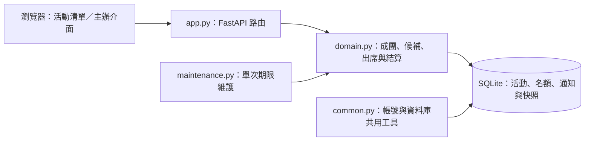

# RallyReady｜校園運動揪團與候補協調平台

> 清楚區分已報名、候補保留與實際出席，讓成團狀態不再靠猜。

## 系統簡介

RallyReady 是給校園臨打與小型運動活動主辦人使用的網頁 App。主辦人可設定活動、容量、成團門檻與截止時間；球友報名後，系統依確認名額與候補規則協調遞補，並在活動後以實際出席者產生費用分攤紀錄。

這是全新 AI 協作作品集 v1.1，不是先前 Flutter 課程作業的原始碼重建；未串接真實場館、收款、Email 或背景推播。

## 使用情境與開發動機

- 把聊天群組中模糊的「可能會來」，轉成明確的確認、候補與待回覆狀態。
- 滿額後依順序釋出限時候補邀請，避免有人退出後由人工逐一追問。
- 依實際出席而非口頭報名人數分攤費用，留下可回看的結算快照。

## 核心功能

| 功能 | 說明 |
| --- | --- |
| 活動建立與探索 | 設定運動、場地、日期、人數門檻、容量、截止與費用；依日期及條件尋找活動。 |
| 報名與成團 | 容量內確認、額滿候補；確認人數不足時明確標示風險。 |
| FIFO 限時候補 | 名額釋出後依序保留，必須本人接受；逾期再交下一位。 |
| 主辦公告與站內通知 | 限主辦發公告，以請求碼避免重複發布；站內資料不是手機推播。 |
| 簽到與費用分攤 | 主辦記錄實際出席，以整數新台幣分攤並保存結算快照，不收款。 |
| 個人活動與 PWA | 區分公開活動與本人相關活動；離線只保留公開介面。 |

## 技術選型

| 層次 | 技術 | 用途 |
| --- | --- | --- |
| 後端 | Python 3.11–3.13、FastAPI、Pydantic | 活動、報名、候補、簽到與結算 API。 |
| 資料庫 | SQLite | 活動狀態、名額、候補、通知與快照。 |
| 前端 | HTML、CSS、原生 JavaScript、PWA | 日期帶、活動清單、詳情與操作回饋。 |
| 維護工具 | maintenance.py | 單次處理期限；自動排程需另行設定。 |
| 驗證 | pytest、Node 測試、LinkeDOM、GitHub Actions | 規則、平行報名、期限與模擬 DOM 事件。 |

## 系統架構



上圖依現有模組呈現 HTTP、領域規則與資料存取的關係；各項規則與執行邊界見後續章節。

## 工程設計重點

| 設計面向 | 實作方式 |
| --- | --- |
| 狀態與承諾分離 | 候補保留占容量，但不算已確認成團人數，避免畫面誤導主辦。 |
| 交易內名額更新 | 在報名／退出／接受候補流程檢查並更新名額，避免平行請求超額。 |
| 可測試的時間規則 | 以可注入時鐘驗證截止、逾期與結算，不要求等待真實數小時。 |
| 整數費用與快照 | 按出席者分攤整數新台幣，餘數依報名順序分配；不宣稱完成金流支付。 |

## v1.1：校園臨打看板，不是另一份卡片樣板

- **不同的 UI 語言**：深墨綠／萊姆黃、日期帶、按日分組的球局清單與人數計分板；手機採清單／詳情兩個畫面，不把操作壓在長卡片下方。
- **找球局／我的球局分開**：依運動、名稱／場地、七日日期帶、可報名狀態篩選，另外查看本人主辦或曾報名的活動。
- **候補更清楚**：顯示等待順位、名額保留倒數與本人接受按鈕；倒數只是提示，接受仍由伺服器裁決。
- **主辦公告**：限主辦發布、參與者可讀；寫入站內通知，重試使用同一請求碼，不重複發布／通知。
- **更安全的操作**：退出／取消／結算再次確認；建立表單保留本次頁面草稿，登出清除草稿與私人通知。開頁時每 30 秒檢查站內通知，不改寫正在填的表單，不冒充推播。

實際參考與取捨見 [UIUX.md](UIUX.md)。本版尚未完成實際瀏覽器桌機／手機視覺驗收；[舊版截圖](screenshot.jpg) 僅記錄 v1.0，不代表此版 UI。

## 成團規則與產品邊界

- **成團狀態機**：招募中 → 達標／人數不足待補位 → 截止成團或取消 → 出席與結算。候補保留不算成團人數。
- **不超賣的候補**：容量內確認，額滿進 FIFO 隊列；退出釋出限時邀請，必須本人接受。保留中佔容量，逾時才交下一位，重排回隊尾。
- **到場才有的帳**：主辦人記錄簽到，活動結束依出席者以整數新台幣平分，餘數按報名先後分配；結算快照不可更改，不實際收款。
- **規則可見**：門檻、截止、回覆時間、備案、總費用、自己的報名狀態、站內通知與主辦流程紀錄。
- **分享與隱私**：訪客看公開活動摘要；主辦人及曾報名者才可看暱稱名單。不收集電話、電子郵件、學號或定位。
- **PWA**：桌機／手機介面、可安裝 manifest 與原創圖示；離線只保留公開介面，不快取個人 API，也不偷偷排程報名。

市售 OpenSports 已有成熟的自動候補，不能把這當作我們發明。本案聚焦可自架的校園小團、明確成團門檻與出席分攤；不是全面優於商業產品。詳見 [產品與競品研究](PRODUCT.md)。

## 快速啟動

Python 3.11–3.13，無外部服務金鑰；Node 不是啟動必要條件。

```powershell
python -m venv .venv
.venv\Scripts\python -m pip install -r requirements.lock.txt
.venv\Scripts\python -m uvicorn app:app --host 127.0.0.1 --port 8000
```

macOS / Linux 的 Python 路徑改為 `.venv/bin/python`。瀏覽 <http://127.0.0.1:8000>，自行註冊、建立活動。請使用示範密碼，不要重用真實服務密碼。API 文件：`/docs`。

選用虛構資料（僅允許全新資料庫，不刪除或覆寫既有資料）：

```powershell
.venv\Scripts\python seed.py
```

建立 3 場未來活動、4 個示範帳號。`demo0` 是主辦，`demo1`–`demo3` 是球友；**隨機密碼只在本機終端顯示**，不寫入文件。帳號、活動與場地均明確標示為示範。不要把示範資料庫或密碼上傳。

| 環境變數 | 說明 |
|---|---|
| `RALLYREADY_DB` | 預設 `data/rallyready.db`，須位於持久磁碟 |
| `COOKIE_SECURE` | HTTPS 部署設為 `1`，本機 HTTP 用 `0` |

環境變數由作業系統傳入，不自動讀取 `.env`。

## 三分鐘示範

1. 主辦建一場 2 人上限、2 人成團、NT$301 的活動，未來截止；主辦不會自動佔位。
2. A、B 報名確認，C、D 加入候補。A 退出後，C 收到限時保留，狀態變為缺人待補。
3. C 主動接受才恢復成團；若逾時由 D 接續，後來者不能跳過保留名額。
4. 截止時只有一人確認會取消，未回覆的候補不湊成團人數。
5. 活動開始前 30 分鐘後、已截止成團，主辦才能簽到；結束後結算兩位實際出席者為 NT$151 / NT$150，未發生付款。

期限測試用可注入時鐘，不必為展示等待幾小時；自動測試涵蓋截止、逾期與結算。UI 展示請用真正的未來時間，不要改系統時鐘。

## 候補什麼時候處理？

讀取活動、查詢通知與報名變更會重新檢查期限；如需無人開頁面時也處理，另以系統排程每分鐘執行：

```powershell
.venv\Scripts\python maintenance.py
```

本 Repository 提供一次性維護命令，**沒有替使用者安裝排程**。通知是站內資料；頁面可見且未開對話框時，每 30 秒檢查通知數並提示更新，完整狀態仍需更新／開啟通知。未接入寄信或推播服務；不要把它當緊急通知管道。

## 測試

```powershell
.venv\Scripts\python -m pip install -r requirements-dev.lock.txt
.venv\Scripts\python -m pytest -q
node --check app.js
npm ci --ignore-scripts --no-audit --no-fund
npm test
```

Node 22+ 僅用於測試。v1.1 開發時的本機紀錄為 **47 項 Python + 12 項 Node 測試**通過：平行報名不超額、FIFO／逾期、成團、出席結算、整數餘數、行事曆與 session 安全，加上清單篩選、我的活動隔離、等待順位、公告授權／冪等／通知。LinkeDOM + 模擬 API 測試日期帶、篩選事件、草稿、登出與過期回應不還原身份；不是實際瀏覽器端到端、視覺或背景通知測試。CI 設定 Windows / Ubuntu × Python 3.11 / 3.12 / 3.13，實際遠端結果以 [Actions](https://github.com/Ct2510/RallyReady/actions) 為準。

## 部署邊界與目前限制

FastAPI / Pydantic / SQLite / 原生 JavaScript。詳見 [ARCHITECTURE.md](ARCHITECTURE.md)、[API.md](API.md)。選擇可讀的領域模型與交易測試，而非堆砌服務。

初版不是場地預約、支付、背景訊息、身份驗證或違約裁決平台；不保證真實出席。相同自然人可註冊多帳號；人數限制只針對帳號，非經查驗身份。曾報名帳號可看暱稱名單，公開活動不適合敏感群組。

正式服務仍需帳號復原與刪除、通知投遞、反濫用、監控、資料庫遷移、備份還原、負載測試及場地取消規則。PWA 安裝因平台而異，HTTPS 必要；無原生 App 上架。附 Dockerfile，容器建置本機未驗證。

## 原創與參考

功能研究參考 OpenSports、Meetup、pickup、Sports Club Manager；本版 UI 另參考 Luma、Partiful 與 OpenLuma 的資訊階層及狀態表達，沒有複製其程式、圖片、版面或資料。研究見 PRODUCT.md、UIUX.md。本 Repository 尚未另選開源授權，公開不代表任意再利用；Python 依賴依各自授權，測試依賴 LinkeDOM（ISC）及鎖檔相依，不上傳 node_modules。
